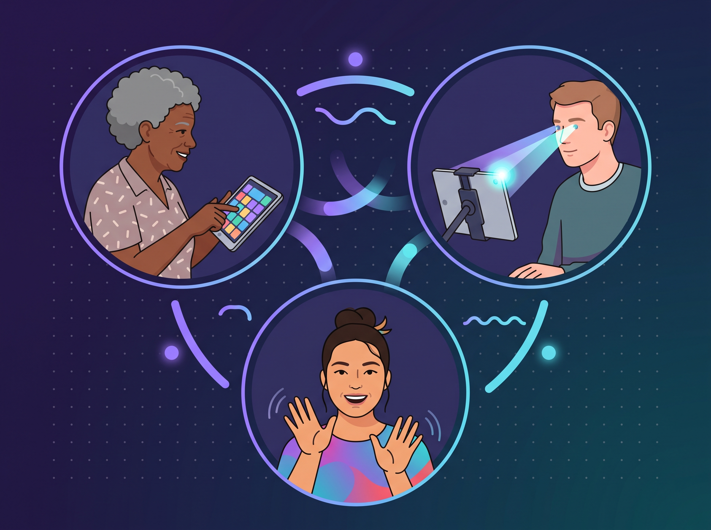

# assets

Arquivos visuais do Toda Voz. A identidade completa (cores, fonte, acessibilidade) está em [context/identidade-visual.md](../context/identidade-visual.md), e a escolha do logo em [decisão 0014](../context/decisoes/0014-logo-oficial.md).

## Logo

  

O símbolo junta três formas, e cada uma representa um jeito de se expressar:
- **Ponto:** o olhar e a intenção, ou seja, quem se comunica com os olhos ou com um único movimento.
- **Haste:** o gesto e o sinal, inclusive a Libras.
- **Arco:** a voz que sai e chega até o outro.

Juntas, as três dizem o que o projeto acredita: **toda forma de comunicação é voz.**

O logo foi criado com ajuda de IA, a partir do [prompt](../context/identidade-visual.md#logo) do projeto, e escolhido pelo Carlos entre outros conceitos.

| Arquivo | Para que serve |
|---|---|
| [`logo/toda-voz-horizontal-claro.svg`](logo/toda-voz-horizontal-claro.svg) | Símbolo + nome + frase, para fundos claros |
| [`logo/toda-voz-horizontal-escuro.svg`](logo/toda-voz-horizontal-escuro.svg) | Símbolo + nome + frase, para fundos escuros (sem fundo próprio) |
| [`logo/toda-voz-simbolo.svg`](logo/toda-voz-simbolo.svg) | Só o símbolo, com o gradiente |
| [`logo/toda-voz-simbolo-mono.svg`](logo/toda-voz-simbolo-mono.svg) | Só o símbolo, em uma cor (usa a cor do texto em volta) |
| [`logo/toda-voz-icone-app.svg`](logo/toda-voz-icone-app.svg) | Ícone quadrado de app (símbolo sobre fundo claro) |
| [`logo/toda-voz-favicon.svg`](logo/toda-voz-favicon.svg) | Ícone da aba do navegador: só o símbolo, sem fundo e ocupando o espaço todo. As cores mudam sozinhas em abas claras e escuras |
| [`logo/alternativas/`](logo/alternativas/) | Conceitos que não foram escolhidos (olho + onda, diálogo), guardados como histórico |

## Ilustrações

  

A ilustração do topo da página inicial mostra pessoas se comunicando de jeitos diferentes. Ela foi criada com ajuda de IA a partir do prompt da versão 2. O prompt e o histórico (a versão 1 foi reprovada) estão em [identidade visual](../context/identidade-visual.md#ilustração-do-topo-da-página-inicial).

| Arquivo | Para que serve |
|---|---|
| [`ilustracoes/originais/topo-original.jpg`](ilustracoes/originais/topo-original.jpg) | Ilustração do topo (versão 2), original em alta resolução |
| [`ilustracoes/alternativas/reprovada-v1/`](ilustracoes/alternativas/reprovada-v1/) | Primeira versão, reprovada (recorte ruim, corpos cortados, mãos formando sinais) |
| [`ilustracoes/alternativas/conceito-vetor-simples.svg`](ilustracoes/alternativas/conceito-vetor-simples.svg) | Proposta vetorial que não foi usada |

**Para gerar a versão do site:**
1. Coloque a imagem em `ilustracoes/originais/topo-original.jpg`.
2. Na raiz do repositório, rode `python3 -I tools/imagens/preparar-ilustracoes.py`.
3. O script reduz a imagem e salva um WebP leve em `apps/site/public/ilustracoes/`.

Se algum dia for preciso usar uma imagem com fundo branco, o script também consegue tirar o fundo: é só marcar `remover_fundo` como `True` nele.

## Como usar
- **Respiro:** deixe em volta do logo um espaço livre de pelo menos a altura do ponto do símbolo.
- **Tamanho mínimo:**
  - 16px para o símbolo ou ícone;
  - 120px de largura para a versão horizontal.
- **Não distorça, não gire e não troque as cores.** Em fundos coloridos ou sem contraste suficiente, use a versão em uma cor só.
- **Fonte do nome:** os arquivos horizontais usam Atkinson Hyperlegible Next. Se ela não estiver instalada, o computador troca por outra fonte sem serifa. No site, o nome é escrito em texto, com a fonte certa.
- **Frase:** sempre em letras normais ("Toda voz importa"), nunca em CAIXA ALTA, que é mais difícil de ler para pessoas com dislexia.

## Licença
Estes arquivos fazem parte do conteúdo do projeto e seguem a [CC BY-NC-SA 4.0](../LICENSE-CONTENT.md): uso livre, sem fins comerciais.
